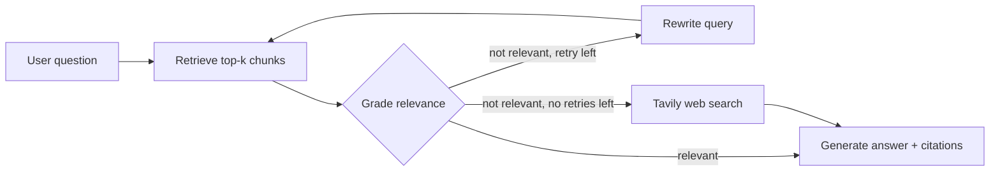

# Agentic RAG Assistant

A document question-answering assistant built with **LangGraph**. It answers from your own PDF/TXT files first, checks whether the retrieved text is actually relevant, retries with a rewritten query, and only then falls back to live web search. Every answer shows its sources (file and page, or URL) and a step-by-step trace of what the agent did.

The repo also includes an **evaluation harness** that measures retrieval quality, routing accuracy, answer correctness and faithfulness, so changes can be judged with numbers rather than impressions.

## How it works



- **Retrieve:** top-4 chunks from a Chroma vector store (`all-MiniLM-L6-v2` embeddings, 800-character chunks, 150 overlap).
- **Grade:** an LLM returns a structured true/false verdict on whether the chunks help answer the question.
- **Rewrite and retry:** if not relevant, the query is rewritten once and retrieval is repeated (`MAX_RETRIES`, default 1).
- **Web fallback:** Tavily search, used only when the documents cannot answer.
- **Generate:** the answer is produced from the retrieved context only, with source labels.

**Stack:** Python, LangGraph, LangChain, Chroma, Sentence-Transformers, Groq (`openai/gpt-oss-20b`), Tavily, Streamlit.

## Features

- Upload PDF and TXT files; add documents incrementally (re-uploading a file replaces its old chunks)
- Page-level citations for document answers, URLs for web answers
- "Agent steps" panel showing every retrieve / grade / rewrite / search decision
- Graceful handling of missing API keys, scanned PDFs with no text, and web-search failures

## Setup

```bash
git clone https://github.com/davii1207/agentic-rag-assistant.git
cd agentic-rag-assistant
python -m venv venv
# Windows: venv\Scripts\activate      macOS/Linux: source venv/bin/activate
pip install -r requirements.txt
```

Create a `.env` file in the project root:

```
GROQ_API_KEY=your_groq_key
TAVILY_API_KEY=your_tavily_key
```

Run the app:

```bash
streamlit run app.py
```

## Evaluation

The `eval/` folder contains four scripts that form a reproducible pipeline:

| Script | Purpose |
|---|---|
| `generate_dataset.py` | Writes candidate questions from real chunks of your documents, so the correct source page is known |
| `review_dataset.py` | Interactive tool to keep, drop, edit or clean each question by hand |
| `run_eval.py` | Runs a retrieval-only test (hit@k, MRR) and the full agent on every question; saves latency, route and sources |
| `judge_eval.py` | LLM-as-judge scoring: correctness vs. a reference answer, faithfulness to the retrieved context, relevance |

```bash
python eval/generate_dataset.py --file <part of your PDF's name>
python eval/review_dataset.py
python eval/run_eval.py --name baseline
python eval/judge_eval.py --name baseline
python eval/run_eval.py --name ret_cs400 --chunk-size 400 --overlap 80 --skip-agent   # retrieval-only, no API calls
```

The dataset is not included in this repository because it contains excerpts of the source textbook. Run the scripts on your own documents to reproduce it.

### Baseline results

Evaluation set: one slide-style cybersecurity textbook (PDF). The runs below used **28 document-grounded questions** (page-level ground truth) plus **10 out-of-scope questions** that should go to web search. Two independent runs with identical settings:

| Metric | Run 1 | Run 2 |
|---|---|---|
| Routing accuracy (docs vs. web) | 100% | 100% |
| Fully correct answers (strict) | 78.6% (22/28) | 82.1% (23/28) |
| Correct or partially correct (lenient) | 87.5% | 89.3% |
| Faithfulness, answers from documents | 89.3% (25/28) | 82.1% (23/28) |
| Faithfulness, answers from web | 70% | 70% |
| Out-of-scope answers that address the question | 100% | 100% |
| Average latency per question | 9.2 s | 8.8 s |
| Average query rewrites per question | 0.34 | 0.34 |

Retrieval only (is the correct page among the top-k chunks?):

| hit@1 | hit@3 | hit@5 | hit@10 | MRR@10 |
|---|---|---|---|---|
| 57.1% | 82.1% | 85.7% | 96.4% | 0.698 |

### What the evaluation found

- **Data quality matters.** 5 of the 28 auto-generated questions contained wording like "according to the passage". They were rewritten or removed after the first runs, and the dataset is now 25 answerable questions.
- **Results are noisy.** With about 28 questions, one question is worth 3.6 percentage points, and two identical runs differed by about two questions. Differences smaller than that should not be treated as real.
- **Faithfulness is the main weakness.** Some document answers add facts that are not in the retrieved text (for example, listing example attacks that the context never mentions), and web answers add details beyond the search snippets.
- **The correct page is usually found but not ranked first** (96% within the top 10, but 57% at rank 1), which makes retrieval ranking a clear next target.

### Limitations (please read)

- Single document, small question set; the numbers are indicative, not a benchmark.
- Questions were generated from chunks by an LLM and then reviewed by hand. This style of dataset can make retrieval look easier than it is.
- The judge (`gpt-oss-120b`) is from the same model family as the agent (`gpt-oss-20b`), and it has **not yet been validated against human labels**, so judge scores should be treated as approximate.
- Page-level ground truth is strict: a topic covered on several pages counts as a miss if a different page is retrieved.
- Free-tier API limits made repeated runs slow; the results above come from two runs rather than a larger sample.

## Roadmap

- [ ] Grounding check after generation to reduce unsupported claims, measured against the baseline
- [ ] Ablations: query rewriting on/off, chunk size, and `k`, with repeated runs and ranges
- [ ] Validate the judge against hand-labelled answers; try a judge from a different model family
- [ ] Reranking to improve hit@1
- [ ] Unit tests and a Dockerfile

## Project structure

```
app.py               Streamlit interface
agent_graph.py       LangGraph agent (retrieve, grade, rewrite, web search, generate)
rag_pipeline.py      Loading, chunking, embeddings and the Chroma store
eval/                Evaluation scripts (see above)
requirements.txt
```
